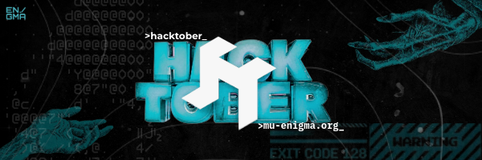

# Hack Day | Hacktoberfest 2026

Welcome to the official submission repository for **Hack Day**, a one-day hackathon hosted by [MU Enigma](https://mu-enigma.org/).

Pick a personal and creative problem from everyday life, then build a solution to it. You may participate individually or as a team, and you may use AI tools, open-source AI, open-weight models, and AI agents.

## Event details

- **Date:** Monday, 12 October 2026
- **Time:** 6:49 PM
- **Location:** ELT-2
- **Build time:** 4 hours
- **Registration:** [tally.so/r/zxpZB0](https://tally.so/r/zxpZB0)
- **Voting:** Projects will be shared on [mu-enigma.org](https://mu-enigma.org/) for public voting. Voting closes on **30 October 2026 at 11:59 PM**.

## Submit your project

1. **Fork** this repository.
2. **Clone** your fork and create a new branch:

   ```bash
   git clone https://github.com/YOUR-USERNAME/Hacktoberfest26-HackDay.git
   cd Hacktoberfest26-HackDay
   git checkout -b submission/your-team-name
   ```

3. Inside `submissions`, create a folder named after your team. Use lowercase letters and hyphens, for example:

   ```text
   submissions/
   └── team-code-crafters/
       ├── README.md
       ├── src/
       └── ...your project files
   ```

4. Put your complete project inside that folder. Include a `README.md` with:

   - Team name and member names
   - The problem you chose
   - Your solution
   - Technologies used
   - Clear setup and run instructions
   - A demo link or screenshots, if available

   You can copy [the team README template](templates/team-readme-template.md) to get started.

5. Commit and push your work:

   ```bash
   git add submissions/your-team-name
   git commit -m "Add submission from your-team-name"
   git push origin submission/your-team-name
   ```

6. Open a **Pull Request** from your fork to this repository's `main` branch. Complete the Pull Request template and submit it.

## Submission rules

- Add or edit files only inside your own team folder.
- Submit one folder and one Pull Request per team.
- Make sure the project can be run using the instructions in your team README.
- Do not commit passwords, API keys, `.env` files, personal data, or generated dependency folders such as `node_modules`.
- Be respectful of other teams' work and use only content you have permission to share.

Need help? Ask an MU Enigma organizer at the event.

## License

This repository is available under the [MIT License](LICENSE). A submission may include its own license inside its team folder when required.
